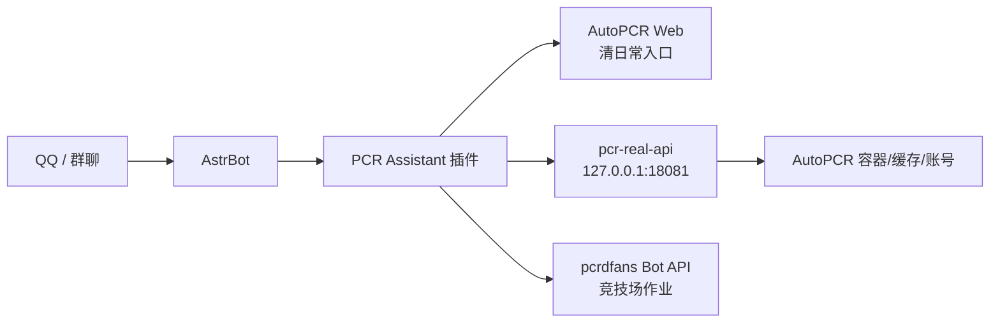

<p align="center">
  
</p>

<h1 align="center">PCR Assistant</h1>

<p align="center">
  面向自用和小群的公主连结 AstrBot 助手：AutoPCR 清日常入口、竞技场查询/推送、会战出刀监控、pcrdfans 作业查询，一起收进一个插件里。
</p>

<p align="center">
  <a href="https://github.com/Mitsukikis/astrbot_plugin_pcr_assistant/releases/download/v0.1.0/astrbot_plugin_pcr_assistant-v0.1.0.zip">下载 v0.1.0 ZIP</a>
  ·
  <a href="#快速开始">快速开始</a>
  ·
  <a href="#命令速查">命令速查</a>
  ·
  <a href="#致谢与参考">致谢与参考</a>
</p>

---

## 这是什么

`astrbot_plugin_pcr_assistant` 是一个为 AstrBot 编写的 PCR 自用助手插件。它的目标不是做一个“看起来像机器人”的外壳，而是把真实可用的几个流程串起来：

- 给群里发清日常入口，跳转到自己的 AutoPCR Web。
- 按 QQ 绑定账号，每个 QQ 使用自己的 AutoPCR 账号，不串号。
- 查询真实 JJC/PJJC 排名、历史和当前场排行榜。
- 做竞技场排名变化推送，支持群推送或私聊推送。
- 查询 pcrdfans 竞技场作业，支持文字阵容和简单五头像图片识别。
- 做会战出刀监控、当前战报、今日战报、我的战报和出刀详情。
- 用管理员 QQ、群开关、黑名单保护群内功能，不相信群名片。

这个插件适合“自己服务器 + 自己 AstrBot + 自己 AutoPCR”的部署方式。它不会提供游戏账号，也不会绕过上游站点/API 的访问限制。

## 架构



插件主体只跑在 AstrBot 里；真实游戏数据由 `sidecar/pcr_real_api.py` 在 AutoPCR 镜像内读取。这样做的好处是 AstrBot 不需要直接安装 AutoPCR 的内部依赖，也能复用 AutoPCR 已保存的账号和缓存。

## 功能状态

| 模块 | 状态 | 说明 |
| --- | --- | --- |
| 清日常链接 | 可用 | 返回你自己的 AutoPCR 登录地址 |
| 私聊账号绑定 | 可用 | 支持渠道服/B 服绑定，按发送者 QQ 存储 |
| 群功能开关 | 可用 | 管理员 QQ 控制启用/禁用 |
| 竞技场查询 | 可用 | 真实读取账号所在场、JJC/PJJC 排名 |
| 竞技场排行榜 | 可用 | `竞技场排行榜1` = 1-20，`2` = 21-40 |
| 排名变化推送 | 可用 | 支持群/私聊推送，用户顶号后暂停 |
| pcrdfans 作业 | 需要 Key | 需要 `pcrdfans_api_key` |
| 会战战报 | 可用 | 读取 AutoPCR 账号的真实会战信息 |
| 预约/挂树/SL 等完整会战协作 | 部分占位 | 本地状态已接入，深度协作仍在迭代 |

## 快速开始

### 1. 安装插件

进入 AstrBot 插件目录：

```bash
cd /path/to/AstrBot/data/plugins
git clone https://github.com/Mitsukikis/astrbot_plugin_pcr_assistant.git
```

重启 AstrBot，或在 WebUI 里重载插件。

### 2. 准备 AutoPCR

本插件默认认为 AutoPCR Web 暴露在：

```text
http://127.0.0.1:18080/daily
```

公网登录页可以填成：

```text
http://你的服务器IP:18080/daily/login
```

AutoPCR 项目地址：<https://github.com/cc004/autopcr>

### 3. 启动真实数据 sidecar

把 `sidecar/pcr_real_api.py` 挂进 AutoPCR 镜像运行。示例：

```bash
docker run -d \
  --name pcr-real-api \
  --restart unless-stopped \
  -p 127.0.0.1:18081:18081 \
  -v autopcr_autopcr_cache:/app/cache \
  -v autopcr_autopcr_log:/app/log \
  -v autopcr_autopcr_result:/app/result \
  -v "$PWD/sidecar/pcr_real_api.py:/app/pcr_real_api.py:ro" \
  ghcr.io/cc004/autopcr:latest \
  python3 /app/pcr_real_api.py --host 0.0.0.0 --port 18081
```

检查：

```bash
curl http://127.0.0.1:18081/health
```

期望返回：

```json
{"ok": true, "service": "pcr_real_api"}
```

不要把 `18081` 暴露到公网。它是本机 sidecar，只给 AstrBot 插件调用。

仓库里也提供了 `sidecar/docker-compose.pcr-real-api.example.yml`，你可以按自己的 AutoPCR volume 名称调整后使用。

### 4. 配置插件

在 AstrBot WebUI 的插件配置里填写：

| 配置项 | 示例 | 说明 |
| --- | --- | --- |
| `autopcr_base_url` | `http://127.0.0.1:18080/daily` | AutoPCR 本机地址 |
| `autopcr_public_url` | `http://你的IP:18080/daily/login` | 发给群友的清日常登录页 |
| `pcr_real_api_url` | `http://127.0.0.1:18081` | 真实数据 sidecar |
| `pcrdfans_api_key` | 留空或填 Key | “怎么拆”需要 |
| `monitor_interval_seconds` | `60` | 后台轮询间隔 |
| `admin_qq` / `admin_qqs` | `123456` | 管理员真实 QQ |
| `blocked_qqs` | `111,222` | PCR 功能黑名单 |

## 命令速查

### 群管理

| 命令 | 说明 |
| --- | --- |
| `pcr启用` | 在本群启用 PCR 功能 |
| `pcr禁用` | 在本群禁用 PCR 功能 |
| `pcr状态` | 查看本群开关状态 |
| `pcr帮助` | 查看帮助 |

群管理命令只识别真实 QQ 管理员，不识别群名片、群昵称、群头衔。

### 清日常

| 命令 | 说明 |
| --- | --- |
| `清日常` | 返回 AutoPCR 登录入口 |
| `配置日常` | 返回 AutoPCR 登录入口 |
| `#配置日常` | 兼容写法 |

### 账号绑定

建议私聊机器人发送：

```text
pcr绑定 渠道服 UID <string...>
pcr绑定 b服 UID access_key
pcr账号
pcr解绑
```

插件会把账号绑定到发送者 QQ。群友绑定自己的账号后，后续查询就会登录自己的账号，不会共用管理员账号。

### 竞技场

| 命令 | 说明 |
| --- | --- |
| `竞技场帮助` | 查看竞技场命令 |
| `竞技场绑定 UID [昵称]` | 绑定渠道服 UID |
| `渠竞技场绑定 UID [昵称]` | 花舞兼容写法 |
| `竞技场查询 [uid/序号/@某人]` | 查询真实 JJC/PJJC 排名 |
| `详细查询 [uid/序号]` | 查询更详细的绑定/排名信息 |
| `竞技场订阅状态 [0-8]` | 查看订阅状态 |
| `竞技场设置 1100 [0-8]` | 修改 JJC/PJJC/排名上升/上线提醒开关 |
| `竞技场监控` | 开启当前群查榜监控 |
| `取消竞技场监控` | 关闭当前群查榜监控 |
| `竞技场排行榜1` | 普通竞技场第 1-20 名 |
| `竞技场排行榜2` | 普通竞技场第 21-40 名 |
| `公主竞技场排行榜1` | 公主竞技场第 1-20 名 |
| `公主竞技场排行榜2` | 公主竞技场第 21-40 名 |
| `竞技场杀手` | 查看监控/推送状态 |
| `开启jjc杀手` / `关闭jjc杀手` | 开关 JJC 排名变化提醒 |
| `开启pjjc杀手` / `关闭pjjc杀手` | 开关 PJJC 排名变化提醒 |
| `竞技场记录` | 查询真实 JJC 历史 |
| `击剑记录` | 查询真实 PJJC 历史 |

排行榜命令会登录发送者 QQ 绑定的账号读取游戏数据。如果你正在游戏里，可能会触发顶号。插件检测到顶号/手动登录后会暂停后台监控，需要重新发送命令恢复。

### 竞技场作业

文字阵容：

```text
怎么拆 宫子 怜(新年) 爱蜜莉雅 霞(魔法少女) 似似花
b怎么拆 宫子 怜
台怎么拆 宫子 怜
日jjc查询 宫子 怜
```

图片阵容：发送一张横向五头像截图并附带 `怎么拆`。当前图片识别偏保守，最稳定的是裁剪成一排 5 个头像。

这个功能调用 pcrdfans Bot API，需要在插件配置里填 `pcrdfans_api_key`。没有 Key 时插件会明确报错，不会返回假数据。

### 会战

| 命令 | 说明 |
| --- | --- |
| `出刀监控` | 开启本群会战出刀监控 |
| `关闭出刀监控` | 关闭本群会战出刀监控 |
| `状态` | 查看出刀监控、本地状态和监控账号 |
| `当前战报` | 查询当前会战统计 |
| `今日战报` | 查询今日出刀统计 |
| `我的战报` | 查询自己的出刀 |
| `出刀详情` | 查询真实出刀记录 |
| `开启手动报刀` / `关闭手动报刀` | 保存本群手动报刀开关 |
| `开启图片模式` / `关闭图片模式` | 保存图片模式开关 |

## 安全模型

这个插件一开始就是按“群里有人故意找 bug”的假设设计的：

- 权限只看 QQ 号，不看昵称、群名片、群头衔。
- 每个 QQ 只能默认使用自己私聊绑定的 PCR 账号。
- 管理员账号不会作为群友查询的 fallback。
- 黑名单优先级高于管理员列表。
- 真实数据 sidecar 默认只监听 `127.0.0.1`。
- 运行数据保存在插件 `data/` 下，发布包不包含账号、密码、token、缓存。
- 后台轮询间隔不要设太低，避免频繁登录导致顶号。

## 发布包内容

```text
astrbot_plugin_pcr_assistant/
  main.py
  metadata.yaml
  _conf_schema.json
  logo.png
  sidecar/pcr_real_api.py
  tests/
  README.md
  NOTICE.md
  LICENSE
  releases/astrbot_plugin_pcr_assistant-v0.1.0.zip
```

## 开发与测试

本地静态检查：

```bash
python -m py_compile *.py sidecar/pcr_real_api.py
```

运行测试：

```bash
python -m pytest tests/test_storage_and_parsing.py -q
```

## 常见问题

### 为什么“怎么拆”需要 API Key？

因为 pcrdfans 的 Bot API 会校验 `authorization`。插件不会绕过上游限制，也不会抓取私有接口。没有 Key 时只会提示缺少配置。

### 为什么排行榜会顶号？

排行榜、排名、会战战报来自真实游戏接口，必须登录对应账号读取。只要登录游戏接口，就可能和手机客户端互相顶号。建议把监控间隔保持在 60 秒以上，并在本人手动上号时关闭监控。

### 能不能让别人共用我的账号？

不建议，也不是默认行为。插件按发送者 QQ 选择账号，避免群友命令登录管理员账号。

### 可以商用吗？

不建议。本项目依赖和参考的上游项目包含非商业或 GPL 授权内容，并且涉及第三方游戏服务。请仅用于学习、自用和小范围管理。

## 致谢与参考

本项目参考/借鉴并接入了以下项目或服务：

- [AstrBot](https://github.com/AstrBotDevs/AstrBot)：插件运行平台。
- [AutoPCR](https://github.com/cc004/autopcr)：清日常 Web 和真实游戏账号管理后端。
- [pcrdfans.com](https://www.pcrdfans.com/) / [pcrdfans.com GitHub](https://github.com/peterli110/pcrdfans.com)：竞技场作业数据来源。
- [KokkoroBot](https://github.com/zzbslayer/KokkoroBot)：PCR QQ 机器人生态、竞技场作业查询方式和角色别名数据的重要参考。
- [redive.estertion.win](https://redive.estertion.win/)：运行时角色头像识别缓存来源之一。

本项目不是 Cygames、哔哩哔哩、九游、pcrdfans、AutoPCR 或 AstrBot 官方项目。

## License

本项目以 GPL-3.0 发布。详见 [LICENSE](LICENSE)。

图标素材由使用者提供，仅作为插件展示图使用；请自行确认素材授权。
