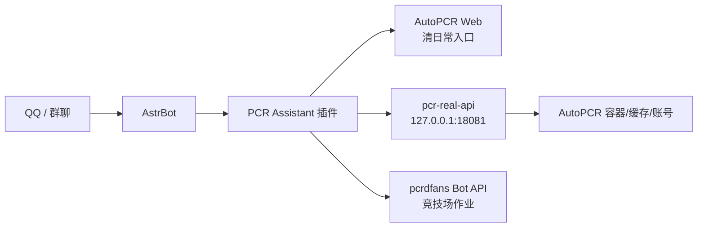

<p align="center">
  
</p>

<h1 align="center">PCR Assistant</h1>

<p align="center">
  面向自用和小群的公主连结 AstrBot 助手：AutoPCR 清日常入口、竞技场查询/推送、会战出刀监控、pcrdfans 作业查询，一起收进一个插件里。
</p>

<p align="center">
  <a href="https://github.com/Mitsukikis/astrbot_plugin_pcr_assistant/releases/download/v0.1.0/astrbot_plugin_pcr_assistant-v0.1.0.zip">下载 v0.1.0 ZIP</a>
  ·
  <a href="#快速开始">快速开始</a>
  ·
  <a href="#命令速查">命令速查</a>
  ·
  <a href="#致谢与参考">致谢与参考</a>
</p>

---

## 这是什么

`astrbot_plugin_pcr_assistant` 是一个为 AstrBot 编写的 PCR 自用助手插件。它的目标不是做一个“看起来像机器人”的外壳，而是把真实可用的几个流程串起来：

- 给群里发清日常入口，跳转到自己的 AutoPCR Web。
- 按 QQ 绑定账号，每个 QQ 使用自己的 AutoPCR 账号，不串号。
- 查询真实 JJC/PJJC 排名、历史和当前场排行榜。
- 做竞技场排名变化推送，支持群推送或私聊推送。
- 识别单队、三队及左右对战履历，返回角色头像与游戏名；有 pcrdfans Key 时直接返回作业图片，没有 Key 时返回带入阵容的官网链接。
- 用结构化图片展示会战成员统计、五王血量和单刀角色伤害，推送真实出刀及正在挑战人数。
- 按公会/会战归档观察到的记录，支持今日、昨日、个人战报及群内预约、挂树、排刀和 SL 登记。
- 用管理员 QQ、群开关、黑名单保护群内功能，不相信群名片。

这个插件适合“自己服务器 + 自己 AstrBot + 自己 AutoPCR”的部署方式。它不会提供游戏账号，也不会绕过上游站点/API 的访问限制。

## 架构



插件主体只跑在 AstrBot 里；真实游戏数据由 `sidecar/pcr_real_api.py` 在 AutoPCR 镜像内读取。这样做的好处是 AstrBot 不需要直接安装 AutoPCR 的内部依赖，也能复用 AutoPCR 已保存的账号和缓存。

## 功能状态

| 模块 | 状态 | 说明 |
| --- | --- | --- |
| 清日常链接 | 可用 | 返回你自己的 AutoPCR 登录地址 |
| 私聊账号绑定 | 可用 | 支持渠道服/B 服绑定，按发送者 QQ 存储 |
| 群功能开关 | 可用 | 管理员 QQ 控制启用/禁用 |
| 竞技场查询 | 可用 | 真实读取账号所在场、JJC/PJJC 排名 |
| 竞技场排行榜 | 可用 | `竞技场排行榜1` = 1-20，`2` = 21-40 |
| 排名变化推送 | 可用 | 支持群/私聊推送，用户顶号后暂停 |
| pcrdfans API 作业 | 需要 Key | 配置 `pcrdfans_api_key` 后优先使用 |
| 公开网页作业 | 可选，无需 Key | 单队最多10条；多队组合去重角色，一次返回联合解法长图 |
| 图片识别 | 无需 Key | 单排/三队/左右履历；模糊、歧义或缺失头像拒识，不强猜 |
| 会战战报 | 可用 | 图片表格、真实成员、伤害占比、未返回分数标记未知 |
| 五王状态/出刀通知 | 可用 | 实时读取 HP、阶段、`fighter_num`；轮询提醒并非游戏服务器主动推送 |
| 预约/挂树/排刀/SL | 本群登记 | 按 QQ 记录，不会替你进入游戏挑战或操作游戏 |
| 完整历史/模拟战斗/BOX 最优配队 | 未实现 | 不把有限采集记录当成整期战报，不声称与花舞全部功能等价 |

## 快速开始

### 1. 安装插件

进入 AstrBot 插件目录：

```bash
cd /path/to/AstrBot/data/plugins
git clone https://github.com/Mitsukikis/astrbot_plugin_pcr_assistant.git
```

重启 AstrBot，或在 WebUI 里重载插件。

### 2. 准备 AutoPCR

本插件默认认为 AutoPCR Web 暴露在：

```text
http://127.0.0.1:18080/daily
```

公网登录页可以填成：

```text
http://你的服务器IP:18080/daily/login
```

AutoPCR 项目地址：<https://github.com/cc004/autopcr>

### 3. 启动真实数据 sidecar

把 `sidecar/pcr_real_api.py` 挂进 AutoPCR 镜像运行。示例：

```bash
docker run -d \
  --name pcr-real-api \
  --restart unless-stopped \
  -p 127.0.0.1:18081:18081 \
  -v autopcr_autopcr_cache:/app/cache \
  -v autopcr_autopcr_log:/app/log \
  -v autopcr_autopcr_result:/app/result \
  -v "$PWD/sidecar/pcr_real_api.py:/app/pcr_real_api.py:ro" \
  ghcr.io/cc004/autopcr:latest \
  python3 /app/pcr_real_api.py --host 0.0.0.0 --port 18081
```

检查：

```bash
curl http://127.0.0.1:18081/health
```

期望返回：

```json
{"ok": true, "service": "pcr_real_api"}
```

不要把 `18081` 暴露到公网。它是本机 sidecar，只给 AstrBot 插件调用。

仓库里也提供了 `sidecar/docker-compose.pcr-real-api.example.yml`，你可以按自己的 AutoPCR volume 名称调整后使用。

### 4. 配置插件

在 AstrBot WebUI 的插件配置里填写：

| 配置项 | 示例 | 说明 |
| --- | --- | --- |
| `autopcr_base_url` | `http://127.0.0.1:18080/daily` | AutoPCR 本机地址 |
| `autopcr_public_url` | `http://你的IP:18080/daily/login` | 发给群友的清日常登录页 |
| `pcr_real_api_url` | `http://127.0.0.1:18081` | 真实数据 sidecar |
| `pcrdfans_api_key` | 留空或填 Key | “怎么拆”需要 |
| `monitor_interval_seconds` | `60` | 后台轮询间隔 |
| `admin_qq` / `admin_qqs` | `123456` | 管理员真实 QQ |
| `allowed_qqs` | 留空 | 额外授权 QQ；留空仅 `admin_qq` 主人可用 |
| `blocked_qqs` | `111,222` | PCR 功能黑名单 |

### 自用权限（0.1.1）

插件默认只允许 `admin_qq` 指定的主人使用。未填写主人或未授权的 QQ 不会收到 PCR 回复，也不会触发游戏账号登录、查询或后台监控。昵称、群名片和群管理员头衔均不能代替 QQ 身份。

主人在需要使用的群发送 `pcr启用` 后，授权 QQ 才能在该群直接发送 `清日常`、`竞技场查询`、排行榜、拆队和会战指令，无需 @ 机器人。未启用群中的业务指令保持静默。主人可以用 `pcr状态` 检查开关，用 `pcr禁用` 关闭本群。

后续分享权限：在插件配置的“额外授权 QQ 列表” (`allowed_qqs`) 中手动加入 QQ，支持逗号、空格或换行分隔，保存并重载插件后生效。删除该 QQ 即可取消权限。`admin_qqs` 仅控制群管理权限，额外管理员也必须列入 `allowed_qqs` 才能使用；黑名单优先于全部授权。

私聊仅向授权 QQ 开放账号绑定、解绑、账号状态、帮助以及切换私聊推送。每个 QQ 继续使用自己绑定的游戏账号。后台竞技场/会战轮询同样检查授权与目标群开关，旧的未授权订阅不会继续查询或推送；私聊推送仅可发给绑定该订阅的 QQ 本人。插件重载或卸载时会停止原监控任务。

运行配置、`data/state.json`、`data/state.secrets.json` 和游戏密码/渠道密钥仅保存在部署服务器，不应提交 Git 或加入发布包。仓库提供通用默认值；新部署请先填写自己的主人 QQ 和 AutoPCR 地址。

## 命令速查

### 群管理

| 命令 | 说明 |
| --- | --- |
| `pcr启用` | 在本群启用 PCR 功能 |
| `pcr禁用` | 在本群禁用 PCR 功能 |
| `pcr状态` | 查看本群开关状态 |
| `pcr帮助` | 查看帮助 |

群管理命令只识别真实 QQ 管理员，不识别群名片、群昵称、群头衔。

### 清日常

| 命令 | 说明 |
| --- | --- |
| `清日常` | 返回 AutoPCR 登录入口 |
| `配置日常` | 返回 AutoPCR 登录入口 |
| `#配置日常` | 兼容写法 |

### 账号绑定

建议私聊机器人发送：

```text
pcr绑定 渠道服 UID <string...>
pcr绑定 b服 UID access_key
pcr账号
pcr解绑
```

插件会把账号绑定到发送者 QQ。群友绑定自己的账号后，后续查询就会登录自己的账号，不会共用管理员账号。

### 竞技场

| 命令 | 说明 |
| --- | --- |
| `竞技场帮助` | 查看竞技场命令 |
| `竞技场绑定 UID [昵称]` | 绑定渠道服 UID |
| `渠竞技场绑定 UID [昵称]` | 花舞兼容写法 |
| `竞技场查询 [uid/序号/@某人]` | 查询真实 JJC/PJJC 排名 |
| `详细查询 [uid/序号]` | 查询更详细的绑定/排名信息 |
| `竞技场订阅状态 [0-8]` | 查看订阅状态 |
| `竞技场设置 1100 [0-8]` | 修改 JJC/PJJC/排名上升/上线提醒开关 |
| `竞技场监控` | 开启当前群查榜监控 |
| `取消竞技场监控` | 关闭当前群查榜监控 |
| `竞技场排行榜1` | 普通竞技场第 1-20 名 |
| `竞技场排行榜2` | 普通竞技场第 21-40 名 |
| `公主竞技场排行榜1` | 公主竞技场第 1-20 名 |
| `公主竞技场排行榜2` | 公主竞技场第 21-40 名 |
| `竞技场杀手` | 查看监控/推送状态 |
| `开启jjc杀手` / `关闭jjc杀手` | 开关 JJC 排名变化提醒 |
| `开启pjjc杀手` / `关闭pjjc杀手` | 开关 PJJC 排名变化提醒 |
| `竞技场记录` | 查询真实 JJC 历史 |
| `击剑记录` | 查询真实 PJJC 历史 |

排行榜命令会登录发送者 QQ 绑定的账号读取游戏数据。如果你正在游戏里，可能会触发顶号。插件检测到顶号/手动登录后会暂停后台监控，需要重新发送命令恢复。

### 竞技场作业

文字阵容：

```text
怎么拆 宫子 怜(新年) 爱蜜莉雅 霞(魔法少女) 似似花
b怎么拆 宫子 怜
台怎么拆 宫子 怜
日jjc查询 宫子 怜
```

图片阵容：发送清晰游戏原图并附带 `怎么拆`。支持一排五头像、三队防守、左右各三队的对战履历；履历默认查询右侧防守队。`识别阵容 全部` 加图片可检查双方识别结果，不查询作业。

支持角色外号与连写，例如 `怎么拆春剑黄骑AMS蚊子布丁`，等同于“怜(新年)、优花梨、爱梅斯、涅比亚、宫子”。字母外号不区分大小写。茉莉可写 `小虎` 或 `跳跳虎`；涅比亚也接受 `捏比亚` 的写法。外号按角色 ID 区分版本，`万圣跳跳虎` 不会被拆成普通茉莉。

0.2.5 对照 BWIKI 的[角色图鉴](https://wiki.biligame.com/pcr/角色图鉴)和[角色别称](https://wiki.biligame.com/pcr/角色别称)，补入 292 个角色的名称/别称资料。现在支持 `els`/`ELS`/`小女朋友`（厄里斯）、`网管`（爱梅斯）、`水m`（空花·夏日）等。词库随插件离线加载，不会每次查询都抓取图鉴。详细来源、覆盖范围和冲突处理见 [角色别名说明](docs/CHARACTER_ALIASES.md)。

主人 QQ 与显式白名单 QQ 可在私聊使用作业查询、识图和多队联合解法，无需启用群聊；群内仍需本群启用 PCR。私聊/群聊均按真实 QQ 号校验，未授权、被拉黑或权限撤销后静默停止。此处仅开放作业查询，不放开私聊清日常、会战或游戏账号监控。

首次部署，在已启用群发送 `竞技场更新卡池`。角色名单来自 sidecar 的游戏静态数据库，头像从公开素材站预热到本地；识图时不临时下载。低清聊天长图中的头像可能不足 30px，请直接发送游戏原图或裁剪五头像横排。

在私聊或已启用群发送 `#怎么拆` 后，十分钟内可连续发送截图；`结束查询` 退出。连续查询会话按 QQ 和聊天会话隔离，不会把群聊截图与私聊截图串在一起。文字多队用 `#` 分隔，每队五名不重复角色。

识图无需 Key；配置 `pcrdfans_api_key` 后优先使用官方 Bot API 返回作业卡片。

**无 Key 的网页模式（0.2.2）：** 在插件配置开启 `pcrdfans_web_query_enabled`，机器人会用匿名 Chromium 打开公开作业页面，带入识别到的五名角色，返回第一页最多10条真实结果截图和来源链接。未找到作业会明确提示，不会生成假解法。无需网站账号密码，不保存登录 Cookie，也不登录游戏账号。

**多队联合解法：** 发送“怎么拆”附三队截图，或以 `#` 分隔两至三队的文字阵容。机器人统一查询各队第一页最多10条候选，再枚举完整组合，一次返回最多10套方案的长图。同一套方案内不得重复任何角色 ID（不同版本角色使用不同 ID）；不同方案是互相独立的备选，不需要互相去重。网站查询遵守至少30秒间隔，因此三队通常需等待一分钟以上，不会每查一队就发一张零散作业图。头像身份不能可靠确认的候选不会参与组合。

联合方案保持防守队伍顺序，不自动调换对位，不会因为某队缺作业就忽略该队。网站只有少量匹配或各队角色冲突时，可能不足5套甚至没有组合，此时会明确说明。结果仅代表当前候选池中的不重人组合，不代表覆盖所有作业；网页点赞和踩数不是模拟胜率，也不会虚构战斗耗时或保证胜利。当前未按自己的持有角色、星级及练度进一步过滤。

浏览器组件需要在 AstrBot 的实际运行环境安装：

```bash
python -m pip install 'playwright>=1.49,<2'
python -m playwright install --with-deps chromium
```

该模式默认关闭，每次重新查询，不缓存作业结果；串行执行，查询至少间隔30秒，多队会依次等待。网站出现登录要求、验证码或访问限制时停止并冷却10分钟，不绕过验证、不破解网页签名，也不直连未授权私有接口。页面结构改变、浏览器依赖缺失或网络超时都会退回带阵容的手动链接。这是公开网页的有限自动化，不等同于获得 Bot API 授权，站方政策变化时需停用。

### 会战

| 命令 | 说明 |
| --- | --- |
| `出刀监控` | 开启本群会战出刀监控 |
| `关闭出刀监控` / `取消出刀监控` | 关闭本群会战出刀监控 |
| `状态` | 五王 HP/阶段/挑战人数图片与监控账号游戏名 |
| `当前战报` | 本公会已采集出刀的汇总图片 |
| `今日战报` / `昨日战报` | 本人对应游戏日的战报，可加精确游戏名查询成员 |
| `今日出刀` / `昨日出刀` | 对应游戏日全会出刀统计 |
| `我的战报` | 查询自己的出刀 |
| `出刀详情 history_id` | 真实记录的角色伤害明细图片，不是列表行号 |
| `预约 1王 备注` / `取消预约` / `预约表` | 本群预约登记 |
| `挂树 1王 备注` / `下树` / `查树` | 本群挂树登记 |
| `申请出刀 1王 备注` / `取消申请` / `申请表` | 本群排刀登记 |
| `sl` / `查sl` | 本群 SL 登记，同一 QQ 同一游戏日去重 |
| `开启手动报刀` / `关闭手动报刀` | 保存本群手动报刀开关 |
| `开启图片模式` / `关闭图片模式` | 保存图片模式开关 |

战报仅包含接口返回及监控期间观察到的记录，按公会与会战 ID 隔离，最多保留 5000 条。未监控时丢失的历史不会自动补全，图片会标注覆盖范围。时间按北京时间 05:00 换日；未知时间不归入今日/昨日。没有明确补偿标记不折算半刀，未返回分数不会编造为零，成员同名仍以游戏 viewer_id 分开。

真实监控会占用对应游戏会话。手动登录/顶号导致会话失效时暂停，不持续抢登录；下线后由本人重新发送监控命令。提醒受轮询间隔与游戏接口可用性影响，不保证“即时”。本地预约/挂树/SL 与游戏实际挑战数据分开显示。

## 安全模型

这个插件一开始就是按“群里有人故意找 bug”的假设设计的：

- 权限只看 QQ 号，不看昵称、群名片、群头衔。
- 每个 QQ 只能默认使用自己私聊绑定的 PCR 账号。
- 管理员账号不会作为群友查询的 fallback。
- 黑名单优先级高于管理员列表。
- 真实数据 sidecar 默认只监听 `127.0.0.1`。
- 运行数据保存在插件 `data/` 下，发布包不包含账号、密码、token、缓存。
- 后台轮询间隔不要设太低，避免频繁登录导致顶号。

## 发布包内容

```text
astrbot_plugin_pcr_assistant/
  main.py
  metadata.yaml
  _conf_schema.json
  logo.png
  sidecar/pcr_real_api.py
  tests/
  README.md
  NOTICE.md
  LICENSE
  releases/astrbot_plugin_pcr_assistant-v0.1.0.zip
```

## 开发与测试

本地静态检查：

```bash
python -m py_compile *.py sidecar/pcr_real_api.py
```

运行测试：

```bash
python -m pytest -q
```

## 常见问题

### 为什么“怎么拆”需要 API Key？

因为 pcrdfans 的 Bot API 会校验 `authorization`。没有 Key 时可选择公开网页模式：通过正常浏览器返回真实网页结果截图；网页限制自动访问时只能使用手动链接。网站登录密码不是 Bot API Key，插件不需要也不保存它。

### 为什么排行榜会顶号？

排行榜、排名、会战战报来自真实游戏接口，必须登录对应账号读取。只要登录游戏接口，就可能和手机客户端互相顶号。建议把监控间隔保持在 60 秒以上，并在本人手动上号时关闭监控。

### 能不能让别人共用我的账号？

不建议，也不是默认行为。插件按发送者 QQ 选择账号，避免群友命令登录管理员账号。

### 可以商用吗？

不建议。本项目依赖和参考的上游项目包含非商业或 GPL 授权内容，并且涉及第三方游戏服务。请仅用于学习、自用和小范围管理。

## 致谢与参考

本项目参考/借鉴并接入了以下项目或服务：

- [AstrBot](https://github.com/AstrBotDevs/AstrBot)：插件运行平台。
- [AutoPCR](https://github.com/cc004/autopcr)：清日常 Web 和真实游戏账号管理后端。
- [pcrdfans.com](https://www.pcrdfans.com/) / [pcrdfans.com GitHub](https://github.com/peterli110/pcrdfans.com)：竞技场作业数据来源。
- [KokkoroBot](https://github.com/zzbslayer/KokkoroBot)：PCR QQ 机器人生态、竞技场作业查询方式和角色别名数据的重要参考。
- [redive.estertion.win](https://redive.estertion.win/)：运行时角色头像识别缓存来源之一。
- [花舞使用文档](https://docs.hwmoe.com/zh/cygames/pcr/auto_report_knife)：会战监控的用户交互参考；未取得或使用花舞私有后端源码。
- [HoshinoBot](https://github.com/Ice-Cirno/HoshinoBot) / [yobot_remix](https://github.com/eggggi/yobot_remix)：会战协作、竞技场查询的行为与命令设计参考，不与其数据互通。
- [PCRJJCAnalyzer](https://github.com/Alive24/PCRJJCAnalyzer)：OpenCV 头像识别思路参考；本项目采用本地多变体模板与保守布局校验。

本项目不是 Cygames、哔哩哔哩、九游、pcrdfans、AutoPCR 或 AstrBot 官方项目。

## License

本项目以 GPL-3.0 发布。详见 [LICENSE](LICENSE)。

图标素材由使用者提供，仅作为插件展示图使用；请自行确认素材授权。
